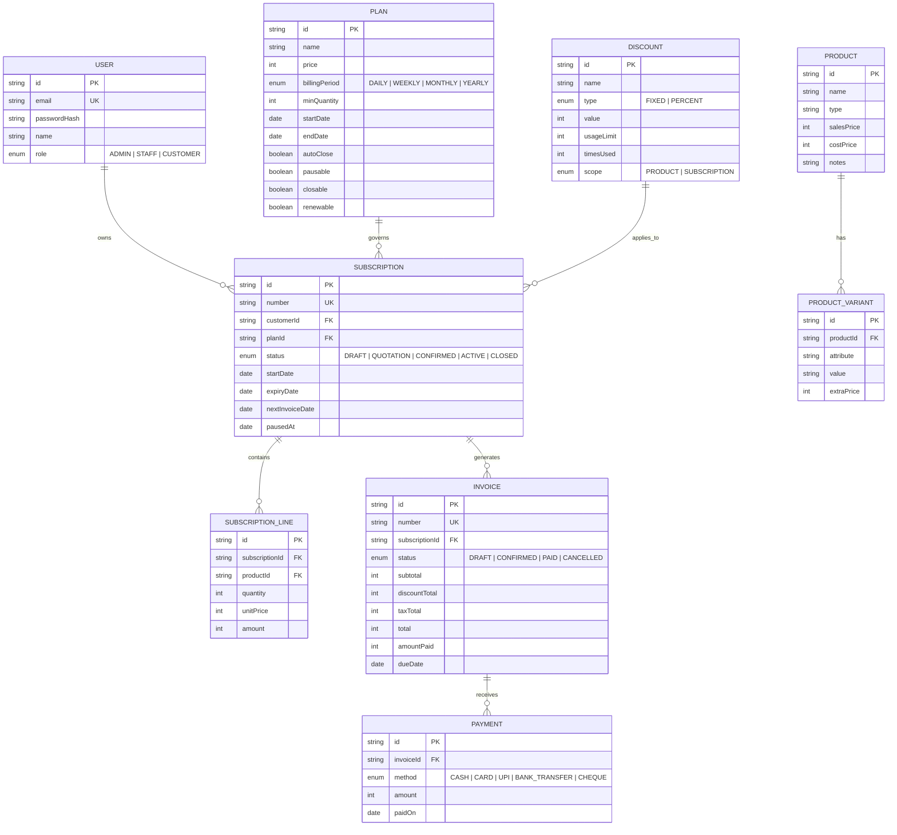
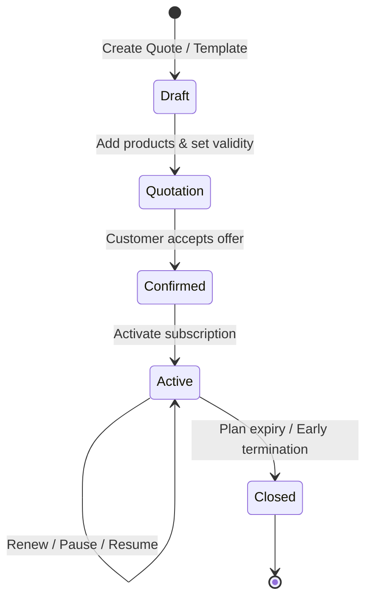
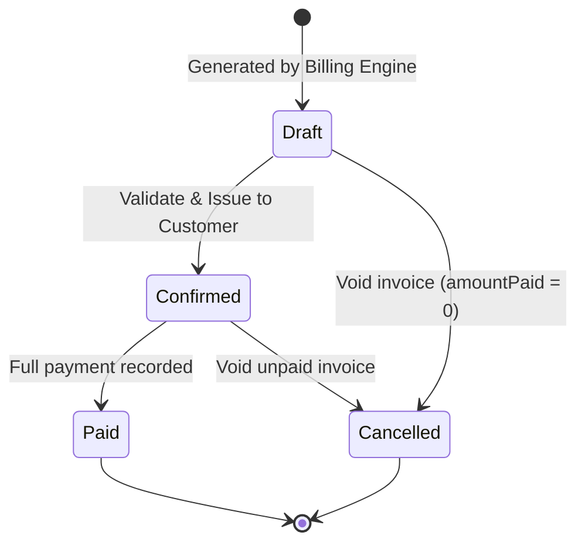

# 🔄 Brightloop Subscription Management System

> **One unified, local-first platform to run plans, subscriptions, and recurring billing in one place.**  
> Built for the **Odoo Hackathon** by a 4-person engineering team.

---

## 📑 Table of Contents
1. [The Challenge & Context](#1-the-challenge--context)
2. [A Month at Brightloop (7 Operational Scenes)](#2-a-month-at-brightloop-7-operational-scenes)
3. [System Architecture & Specifications](#3-system-architecture--specifications)
4. [Odoo Project Expectations & Guidelines](#4-odoo-project-expectations--guidelines)
5. [4-Person Team Roles & Git Workflow](#5-4-person-team-roles--git-workflow)
6. [6-Hour Sprint Execution Plan](#6-6-hour-sprint-execution-plan)
7. [Local Quickstart & Setup Guide](#7-local-quickstart--setup-guide)
8. [Demo Credentials & 3-Minute Judging Script](#8-demo-credentials--3-minute-judging-script)

---

## 1. The Challenge & Context

### The Challenge
Your task is to build **one unified software platform** that runs the full life of a subscription business, from setting up products and plans to sending invoices, collecting payments, and reporting revenue. 

Think of it as the **digital backbone** of a company that earns its money every month, not just once. The system automates and streamlines everything that happens in an ordinary billing month.

### Meet Brightloop Software
**Brightloop Software** sells everything on subscription: business software billed by the month or the year, add-ons customers switch on and off, and products with variants. Customers range from small shops on a monthly plan to large enterprises on annual contracts. 

* **Admin:** Configures products, variants, plans, tax rules, and discounts; manages staff.
* **Internal Team (Staff):** Handles day-to-day operations, quotes, subscriptions, and payments.
* **Customers:** Self-service portal to view and manage their own subscriptions and invoices.

### How Things Run Today (The Pain Points)
* 📋 **Customer subscriptions:** Tracked in spreadsheets
* ⏰ **Renewals:** Remembered by whoever notices first
* ✍️ **Invoices:** Typed up by hand every month
* 🔍 **Payments:** Matched to invoices by scrolling through bank statements
* 📊 **Revenue reports:** Built manually at the end of each quarter

> **The Problem:** Renewals get missed, invoices go out wrong, and nobody can say how much recurring revenue the company actually has.

---

## 2. A Month at Brightloop (7 Operational Scenes)

The scenes below follow one billing month at Brightloop Software, from a new customer creating an account to the finance lead reviewing the numbers.

---

### Scene 1: A New Customer Signs Up (Auth & RBAC)
* **Account Creation & Security:**
  * A small business finds Brightloop online and creates an account with their email and password.
  * **Email Uniqueness:** Each email can belong to only one account (stored lowercase, case-insensitive).
  * **Password Validation:** More than 8 characters (min 9), containing at least one uppercase letter, one lowercase letter, and one special character (`^(?=.*[a-z])(?=.*[A-Z])(?=.*[^A-Za-z0-9]).{9,}$`).
  * **Password Recovery:** If forgotten, a password reset link is sent to their registered email (captured locally in Mailpit, 30-min expiry, single-use token).
* **Role-Based Access Control (RBAC):**
  * **Admin:** Full system control. Only the admin can add new members of staff.
  * **Internal Staff:** Limited access for day-to-day operations and customer requests.
  * **Customers:** Dedicated customer portal viewing strictly their own subscriptions and invoices (isolated via `where customerId = token.customerId`).

---

### Scene 2: Launching a New Plan (Catalog & Variants)
* **Product Catalog & Variants:**
  * Admin sets up products: Name, Type, Sales Price, Cost Price, and Notes.
  * Support for **variants** (e.g., brand-based variants, such as selecting the **Odoo brand adding ₹560 / 56,000 paise** to the sales price).
  * Unit Price = Product Sales Price + Variant Extra Price.
* **Subscription Plan Configuration:**
  * **Pricing & Billing Recurrence:** Daily, Weekly, Monthly, or Yearly.
  * **Minimum Quantity:** Configurable threshold (default $\ge 1$).
  * **Availability Period:** Start date and optional end date.
  * **Lifecycle Policy Flags (Admin configured per plan):**
    * `autoClose`: Automatically closes subscription when plan end date or subscription expiry passes.
    * `closable`: Can be closed early by customer or staff.
    * `pausable`: Can be temporarily paused (pausing skips billing runs).
    * `renewable`: Allows cloning into a new renewal quotation upon completion.

---

### Scene 3: Turning a Quote into a Subscription (Quotation Lifecycle)
* **Quotation Templates:**
  * Sales reps build quotes from pre-configured quotation templates containing predefined plans and product lines, valid for a set number of days (`validityDays`).
* **Subscription Line Details:**
  * Tracks: Human subscription number (`SUB-000123`), Customer, Plan, Start Date, Expiry Date, Payment Terms (days until due), and lines (Product, Variant, Quantity, Unit Price, Tax, Line Amount).
  * Validation: Quantity on every line must meet the plan's minimum quantity.
* **Subscription Lifecycle State Machine:**
  $$\text{Draft} \longrightarrow \text{Quotation} \longrightarrow \text{Confirmed} \longrightarrow \text{Active} \longrightarrow \text{Closed}$$
  * All transitions are guarded; illegal jumps return HTTP `409 Conflict`.
  * Real-time status visible across the entire team.

---

### Scene 4: Billing Day (Automated Invoicing & Taxes)
* **Automated Invoice Generation:**
  * On billing day, the billing engine scans all `ACTIVE` subscriptions where `pausedAt is null` and `nextInvoiceDate <= today`.
  * Generates invoices with customer details, product lines, taxes, and totals pre-calculated.
  * **Idempotency & Integrity:** Enforces a unique database constraint on `(subscriptionId, periodStart)` to guarantee **no subscription is skipped or billed twice**.
* **Automated Taxes & Invoice Actions:**
  * Taxes are calculated automatically from admin-configured rates (e.g. GST 5%, 12%, 18% stored as basis points).
  * Staff can **confirm**, **cancel**, **send** (via local SMTP), or **print** any invoice.
  * **Invoice Lifecycle State Machine:**
    $$\text{Draft} \longrightarrow \text{Confirmed} \longrightarrow \text{Paid}$$
    *(Invoices can move to `Cancelled` from Draft or Confirmed only if `amountPaid == 0`)*

---

### Scene 5: A Customer Asks for a Better Price (Discount Engine)
* **Discount Rules (Admin Managed):**
  * Type: **Fixed amount** (in paise) or **Percentage** (basis points, 0–10,000).
  * Conditions: Minimum purchase amount or minimum quantity.
  * Validity: Start date and end date.
  * Usage Limit: Maximum global usage count (`timesUsed < usageLimit`).
  * Scope: Applicable to **specific products** (`PRODUCT`) or **entire subscriptions** (`SUBSCRIPTION`).
* **Automated Discount Processing:**
  * Order of calculation: Line amount $\rightarrow$ Product discounts $\rightarrow$ Subscription discounts $\rightarrow$ Tax applied to discounted amount.
  * Once applied, discounts reflect on the next invoice without manual calculation.
  * Discounts automatically stop applying once expired or usage limit is exhausted.

---

### Scene 6: The Money Comes In (Payment Reconciliation)
* **Payment Recording:**
  * Log payments against `CONFIRMED` invoices: Payment Method (`CASH`, `CARD`, `UPI`, `BANK_TRANSFER`, `CHEQUE`), Amount, Payment Date, and Reference Note.
  * Validation: Payment amount must be positive and cannot exceed the remaining invoice balance.
  * Automatic state change: When total payments equal total amount, invoice status updates to `PAID`.
* **Receivables Tracking:**
  * Real-time visibility into `Paid` vs. `Outstanding / Overdue` invoices (`status == CONFIRMED && dueDate < today`).

---

### Scene 7: The Finance Lead, at the End of the Month (Dashboard & SLA)
* **Centralized Financial Analytics:**
  * Instant answers to the 4 key leadership questions:
    1. How many subscriptions are currently active?
    2. How much revenue was recognized/collected?
    3. How much money is currently outstanding?
    4. Which invoices are overdue?
  * Built using direct SQL aggregate functions (`COUNT`, `SUM`, `GROUP BY`) for maximum speed.
* **Performance SLA:**
  * Database indexing on `[status, nextInvoiceDate]`, `[status, dueDate]`, `[customerId]`, and `[paidOn]`.
  * Page responses strictly **under 2 seconds** with thousands of records.

---

## 3. System Architecture & Specifications

### Technology Stack (100% Offline & Local-First)

| Layer | Technology | Rationale |
| :--- | :--- | :--- |
| **Backend Runtime** | Node.js 20+, Express, TypeScript | High developer velocity, type safety, robust middleware |
| **Database & ORM** | PostgreSQL 16 (Docker), Prisma ORM | Relational integrity, atomic transactions, automatic migrations |
| **Input Validation** | Zod (Backend & Frontend) | Unified data contracts, `.strict()` input sanitization |
| **Authentication** | JWT (Bearer header), bcrypt | Stateless role-based authentication |
| **Local SMTP / Email** | Mailpit (Docker) | Intercepts all activation/reset emails locally; zero cloud dependency |
| **Scheduler** | `node-cron` + manual trigger API | Background recurring billing + on-demand demo run |
| **Frontend Framework** | React 18, Vite, TypeScript | Ultra-fast HMR, clean component architecture |
| **Styling & Icons** | Tailwind CSS, Lucide React | Consistent Indigo/Slate UI, fully bundled offline |
| **Data Fetching** | TanStack Query v5 | Auto-caching, `keepPreviousData` for seamless pagination |

### Architectural Conventions
* **Money Representation:** Always stored as integer **paise (INR)**. Never floats. Formatted in the UI as `₹ (paise / 100)`.
* **Tax Rates:** Stored as integer **basis points** ($18\% = 1800\text{ bps}$).
* **Human Identifiers:** Sequential human-readable numbers (`SUB-000123`, `INV-000123`) backed by atomic database counters.

### Entity-Relationship Diagram



### State Machine Diagrams

#### Subscription State Flow


#### Invoice State Flow


---

## 4. Odoo Project Expectations & Guidelines

> *"At Odoo, we value your skills, more than your resume. Here's what we expect from you:"*

### 🔧 Must Have Checklist
- [x] **Dynamic Data Sources:** Real PostgreSQL database with Prisma ORM (zero mock JSON files in production).
- [x] **Responsive & Clean UI:** Consistent Indigo/Slate design system, mobile drawer navigation, responsive data cards.
- [x] **Robust Input Validation:** Strict Zod schemas validating on both client and server before DB writes.
- [x] **Intuitive Navigation:** Dedicated sidebars for Admin, Staff, and Customer with contextual action buttons.
- [x] **Proper Version Control (Git):** Distributed team commits and Pull Requests across all 4 teammates.

### 📌 Nice to Have Checklist
- [x] **Backend APIs & Data Modeling:** Relational schema with foreign keys, compound unique constraints, and indexes.
- [x] **Code Comprehension:** Clean service pattern (`*.service.ts`) without unexplainable external black boxes.
- [x] **Offline / Local Solutions:** Complete stack runs offline via Docker (Postgres + Mailpit) — zero cloud reliance.
- [x] **Purposeful Tech Stack:** Standard Express + React + Tailwind stack selected for speed and zero bloat.

---

## 5. 4-Person Team Roles & Git Workflow

To satisfy Odoo's requirement that **"one member managing the repo is not enough"**, work is partitioned into 4 distinct roles:

```
                         ┌────────────────────────────────────┐
                         │       GitHub Repository (dev)      │
                         └────┬──────────┬──────────┬─────────┘
                              │          │          │         │
                        ┌─────▼────┐┌────▼─────┐┌───▼────┐┌───▼────┐
                        │ Person 1 ││ Person 2 ││Person 3││Person 4│
                        └──────────┘└──────────┘└────────┘└────────┘
```

| Member | Focus Area | Branch Name | Responsibilities |
| :--- | :--- | :--- | :--- |
| **Person 1** | **Database & Auth** *(Backend Lead)* | `feature/db-auth` | Docker Compose setup, Prisma schema, migrations, seed script, JWT authentication, RBAC middleware, Mailpit reset flow. |
| **Person 2** | **Billing Engine & Logic** *(Logic Lead)* | `feature/billing-engine` | Subscription state transitions, automated `generateInvoice` engine, discount allocation, payment recording, SQL financial reports. |
| **Person 3** | **Admin Operations UI** *(Frontend Lead)* | `feature/admin-frontend` | App shell, Tailwind theme, Product & Variant manager (+₹560 Odoo variant), Subscription management & lifecycle action buttons. |
| **Person 4** | **Portal & Finance Dashboard** *(Product Lead)* | `feature/portal-and-dashboard` | Customer Self-Service Portal, Finance Lead KPI dashboard, printable HTML invoice view, 3-minute pitch presentation. |

### Git Rules of Engagement
1. **Never commit directly to `main` or `dev`.**
2. Create your branch from `dev`:
   ```bash
   git checkout dev
   git pull origin dev
   git checkout -b feature/<your-role-name>
   ```
3. Commit with semantic commit messages:
   ```bash
   git commit -m "feat(billing): implement idempotent invoice generator"
   ```
4. Push and open a Pull Request into **`dev`** for peer review before merging.

---

## 6. 6-Hour Sprint Execution Plan

```
[0h - 1h] Foundation & DB ──► [1h - 2.5h] Backend Engine ──► [2.5h - 4.5h] Frontend UI ──► [4.5h - 5.5h] Polish ──► [5.5h - 6h] Pitch Prep
```

* **Hour 1 (0:00 – 1:00): Foundation & DB Setup**
  * Spin up Docker (Postgres + Mailpit).
  * Run Prisma migrations and seed demo accounts and catalog.
* **Hours 2 to 2.5 (1:00 – 2:30): Backend APIs & Billing Engine**
  * Auth & RBAC endpoints live.
  * Invoicing service, subscription state transitions, and payment endpoints verified via Postman.
* **Hours 2.5 to 4.5 (2:30 – 4:30): Frontend Implementation**
  * Admin catalog, subscription lifecycle buttons, and payment recording modal.
  * Customer portal and Finance dashboard KPI cards connected to live APIs.
* **Hour 5 (4:30 – 5:30): End-to-End Integration & Polish**
  * Verify all 7 operational scenes flow end-to-end without crashing.
  * Test Mailpit password reset locally; format printable invoices.
* **Hour 6 (5:30 – 6:00): Git Verification & Pitch Rehearsal**
  * Ensure all 4 team members have active commits and merged PRs on GitHub.
  * Rehearse the 3-minute live judging walkthrough.

---

## 7. Local Quickstart & Setup Guide

### Prerequisites
* **Node.js** 20+
* **Docker Desktop**
* **Git**

### 1. Clone & Start Local Services (PostgreSQL & Mailpit)
```bash
git clone https://github.com/Jinsssss333/sub_system.git
cd sub_system
git checkout dev

# Start PostgreSQL (5432) and Mailpit (1025 SMTP, 8025 Web)
docker compose up -d
```

### 2. Backend Setup
```bash
cd backend
npm install
npx prisma migrate dev --name init
npm run db:seed
npm run dev
# Backend API runs on: http://localhost:4000
```

### 3. Frontend Setup
```bash
cd ../frontend
npm install
npm run dev
# Frontend application runs on: http://localhost:5173
```

### 4. Local Mailbox
Open **`http://localhost:8025`** in your browser to view all intercepted password reset and notification emails in real time without internet connectivity.

---

## 8. Demo Credentials & 3-Minute Judging Script

### Pre-Seeded Accounts

| Role | Email | Password | Access Level |
| :--- | :--- | :--- | :--- |
| **Admin** | `admin@brightloop.test` | `Admin@1234` | Full access (Catalog, Staff creation, Billing job, Discounts, Finance) |
| **Staff** | `staff@brightloop.test` | `Staff@1234` | Day-to-day operations (Quotes, Subscriptions, Invoices, Payments) |
| **Customer** | `customer@brightloop.test` | `Customer@1234` | Self-Service Portal (Own subscriptions and invoices only) |

---

### The 3-Minute Live Demo Script for Judges

* **Minute 1: The Problem & Architecture (Person 4 / Pitch Lead)**
  * *"Judges, Brightloop Software was losing revenue due to missed renewals and manual invoicing. We built a 100% offline, local-first subscription engine running PostgreSQL and local SMTP via Docker."*
  * Show `docker-compose.yml` and show that no internet is required.
* **Minute 2: The Core Operational Flow (Person 3 & Person 1)**
  * Log in as **Admin**: Show the product catalog with the **Odoo variant (+₹560)** and a monthly recurring plan.
  * Switch to **Staff**: Create a subscription from a quote template $\rightarrow$ walk status from `Draft` $\rightarrow$ `Quotation` $\rightarrow$ `Confirmed` $\rightarrow$ `Active`.
  * Trigger the billing engine $\rightarrow$ show the invoice generated with automated tax and discount math.
  * Record a payment $\rightarrow$ watch status flip to `PAID`.
* **Minute 3: Customer Isolation & Finance Analytics (Person 2 & Person 4)**
  * Switch to **Customer**: Show that the customer sees *only* their own subscription and invoice, proving customer data isolation.
  * Switch back to **Admin / Finance Lead**: Open the Finance Dashboard to show real-time active subscriptions, revenue collected, and overdue invoices calculated instantly via database aggregations.
